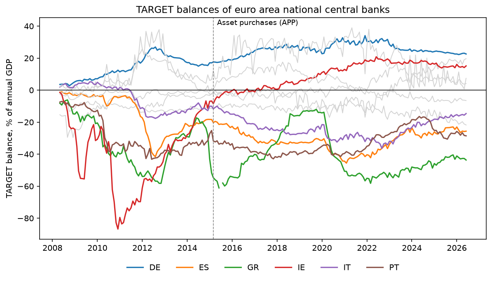
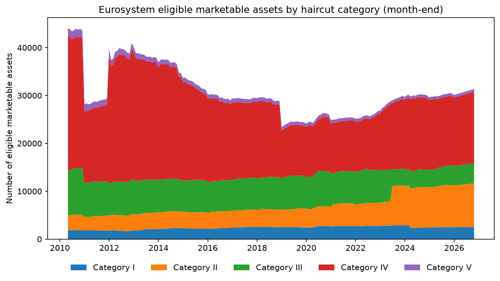
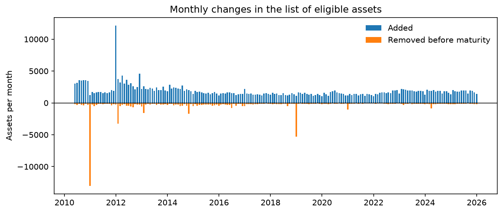

# Euro area market infrastructure: TARGET balances and Eurosystem collateral


This project uses public ECB data to study two pieces of the Eurosystem's market infrastructure:

1. **TARGET balances and sovereign spreads.** A country-month panel of the TARGET balances of
   11 euro area national central banks (2008–2026), estimated with fixed effects in Python and
   replicated in Stata.
2. **The Eurosystem collateral list.** 190 month-end snapshots (April 2010 – October 2026) of
   the list of marketable assets eligible as collateral in Eurosystem credit operations:
   5,852,527 asset-month records, cleaned from three different file formats and stored in SQLite.

Data are downloaded from the ECB Data Portal API and the ECB website, stored in a SQLite database,
analysed in Python (pandas, linearmodels, matplotlib) and Stata, and checked by 19 automated tests
that run on GitHub Actions at every push.

## Background: the TARGET Services

The Eurosystem operates the infrastructure through which central bank money moves in the euro area:

- **T2**, the real-time gross settlement system for large-value payments and central bank operations
  (the successor of TARGET2);
- **TIPS** (TARGET Instant Payment Settlement), for instant payments in central bank money;
- **T2S** (TARGET2-Securities), the common platform where central securities depositories (CSDs)
  settle securities transactions against central bank money;
- **ECMS** (Eurosystem Collateral Management System), which manages the assets that banks pledge
  as collateral to obtain central bank credit;
- **Pontes**, the Eurosystem's solution for settling transactions recorded on distributed ledger
  technology (DLT) platforms in central bank money.

Part 1 of the project looks at T2 through the balances it generates between national central banks;
part 2 looks at the assets that feed collateral management.

---

## Part 1 – TARGET balances and sovereign spreads

When a payment from a bank in Italy to a bank in Germany is settled in T2, the Banca d'Italia
acquires a liability towards the Eurosystem and the Bundesbank a claim. The net position of each
national central bank is its **TARGET balance**. Large negative balances appeared during the
sovereign debt crisis, when deposits left the countries under stress, and again with the asset
purchase programmes, when the liquidity created by purchases ended up in accounts held in a few
financial centres.



### Data

| Variable | ECB dataset | Series key (CC = country) | Frequency |
|---|---|---|---|
| TARGET balance of the national central bank, end of month | TGB | `M.CC.N.A094T.U2.EUR.E` | monthly, from May 2008 |
| 10-year government bond yield (convergence criterion) | IRS | `M.CC.L.L40.CI.0000.EUR.N.Z` | monthly |
| Nominal GDP, seasonally adjusted | MNA | `Q.Y.CC.W2.S1.S1.B.B1GQ._Z._Z._Z.EUR.V.N` | quarterly |

Countries: AT, BE, DE, ES, FI, FR, GR, IE, IT, NL, PT (Luxembourg is excluded as a financial-centre
outlier). TARGET balances are expressed in percent of annual GDP (sum of the last four quarters,
repeated in the three months of each quarter); spreads are measured against the German 10-year yield.
The panel has 2,397 country-months (one month is missing for Greece in mid-2015).

### Model

For country *i* and month *t* (Germany excluded, since its spread is zero by construction):

Δ(TARGET balance / GDP)<sub>it</sub> = β · Δspread<sub>it</sub> + a<sub>i</sub> + g<sub>t</sub> + e<sub>it</sub>

The model is estimated in first differences because balances and spreads are highly persistent.
Month fixed effects g<sub>t</sub> absorb everything common to all countries in a month (ECB
decisions, global shocks), so β compares countries in the same month; country fixed effects
a<sub>i</sub> absorb country-specific trends. Standard errors are clustered by country and, because
10 clusters are few, also computed with the Driscoll–Kraay estimator, which is robust to correlation
across countries and over time. The Stata do-file replicates the regression with `xtreg, fe` and
reports p-values from a t distribution with 9 degrees of freedom.

### Results

| Sample | β | SE clustered (Python) | SE Driscoll–Kraay | p-value (Stata) | Observations |
|---|---|---|---|---|---|
| Full sample, 2008–2026 | −0.71 | 0.31 | 0.32 | 0.055 | 2,168 |
| Crisis years, 2008–2014 | −0.65 | 0.33 | 0.31 | 0.092 | 790 |
| Asset purchase years, 2015–2026 | −1.22 | 0.40 | 0.71 | 0.017 | 1,378 |

A one-point increase in a country's spread over Germany is associated with a fall in its TARGET
balance of about 0.7 percent of GDP in the same month, relative to the other countries. The sign is
the same in both periods and in both programs (the coefficients coincide to four decimals), but the
evidence is statistically weak: with the conservative small-sample inference of Stata the estimate is
significant at 10% for the full sample and the crisis years, and the larger coefficient after 2015 is
imprecise once cross-country correlation is taken into account (Driscoll–Kraay). The regression
describes an association, not a causal effect: stress in a country raises its spread and drives
deposits out of its banks at the same time.

---

## Part 2 – The Eurosystem list of eligible marketable assets

The ECB publishes every working day the full list of marketable assets that banks can pledge as
collateral, with yearly archives back to April 2010. Each record is one asset (identified by its
ISIN) with its haircut category, asset type, currency, issuer and guarantor type, issuer residence,
central securities depository, coupon type, maturity and haircut. The data contain no amounts, so the
analysis counts assets rather than their value.

### Cleaning

`scripts/fetch_collateral.py` downloads the 16 yearly archives (3–4 GB) and keeps the last
working day of each month; `src/collateral.py` turns every snapshot into the same table:

- **Three containers:** `ea_all_*.tgz` (2010–2013, a tar archive with a text file inside),
  `ea_all_*.txt.gz` (2014–2015) and `ea_csv_*.csv.gz` (from 2016). All are tab-separated text
  encoded in UTF-16.
- **Renamed columns:** the category is `LIQUIDITY_CLASS` until 2015 and `HAIRCUT_CATEGORY` afterwards;
  the haircut moves from `VALUATION_HAIRCUT` to `HAIRCUT`; the settlement location from
  `COUNTRY_OF_LOCATION` to `ISSUER_CSD`. A single mapping (`COLUMNS`) gives both formats the same schema,
  and a test checks that an asset written in the old and in the new format produces identical rows.
- **Codes:** countries are extracted from codes such as `IRFR` (issuer residence) and `CLFR01` (CSD);
  dates are converted to ISO format; haircuts to numbers.
- **Validation:** every ISIN is checked against its check digit (Luhn algorithm); invalid codes and
  duplicates would be dropped (none were found).
- **Pitfalls avoided:** all fields are read as text, so codes are not turned into numbers, and the
  string "NA" is kept, because it is Namibia's country code rather than a missing value.

The 190 snapshots are stored in the table `eligible_assets` with primary key `(snapshot_date, isin)`;
loading a month again replaces its rows instead of duplicating them.

### Results



The list shrank from 44,043 assets in April 2010 to about 30,000 from 2016 and stands at 31,340 in
October 2026. Its composition changed: category IV, which today contains unsecured bank debt, fell
from 64% to 48% of the assets, category II almost tripled (from 3,028 to 9,104 assets), and
asset-backed securities (category V) fell from 1,650 to 581.



Comparing consecutive snapshots separates assets that leave the list because they mature from
assets removed while still outstanding, which reflect eligibility decisions. A test on a small invented database checks that this split is computed correctly. The largest movements match changes in the collateral framework:

| Month | What the data show | Related change in the collateral framework |
|---|---|---|
| December 2010 | 13,004 assets removed before maturity, almost all bank debt in category IV, including assets in US dollars and pounds sterling | End of the temporary expansion of October 2008, which had admitted bank debt traded on certain non-regulated markets and assets in US dollars, pounds sterling and yen (eligible until December 2010) |
| November 2012 | Additions include more than 500 assets in US dollars | Assets in US dollars, pounds sterling and yen admitted again (decision of 6 September 2012) |
| December 2018 | 5,320 assets removed before maturity, mostly unsecured bank bonds | End of the transitionf to the new rules for unsecured bank bonds decided in December 2017: bonds not meeting them, including those issued by entities outside the EU, became ineligible, and eligible unsecured bank bonds fell by more than €400 billion |
| June 2023 | 3,218 assets change category, of which 2,997 covered bonds move from category III to II and about 70 assets from II to I | From 29 June 2023 all covered bonds are assigned to category II and EU bonds move to category I |

In December 2011 about 12,000 assets, mostly euro-denominated bank debt in category IV, were added
in a single month; I have not yet identified the legal act behind this change.

About one asset in four (21–30% over the period) is settled in a CSD located outside the issuer's
country. The share shows no break in 2015, when the source field changes from `COUNTRY_OF_LOCATION`
to `ISSUER_CSD`, which supports the harmonisation.

The tables behind the figures are saved in `output/` as CSV files, ready for a dashboard tool.

---

## How to run

```bash
python -m venv .venv && source .venv/bin/activate
pip install -r requirements.txt

python -m scripts.build_database          # download TARGET, yield and GDP series into SQLite
python -m scripts.build_target_panel      # build the country-month panel
python -m scripts.estimate_target_panel   # panel regressions (Python)
python -m scripts.plot_target
# in Stata, from the project root:  do stata/target_panel.do

python -m scripts.fetch_collateral        # yearly archives -> month-end snapshots (3–4 GB download)
python -m scripts.build_collateral_db     # clean and load the 190 snapshots into SQLite
python -m scripts.analyse_collateral      # tables and figures

pytest                                    # 19 tests, no internet connection needed
```

## Structure

```
src/        download.py (ECB API), database.py (SQLite), target.py (panel), collateral.py (cleaning)
scripts/    one script per step of the pipeline
stata/      target_panel.do (replication of the panel regression)
tests/      tests of the download, database, panel construction, cleaning and turnover
output/     result tables (CSV) and the Stata log
figures/    figures used in this README
```

## Limitations

- TARGET balances are aggregate positions of national central banks, not transaction-level data.
- The collateral list contains no amounts outstanding or amounts pledged, and month-end snapshots
  miss changes that are reversed within a month. For 2026 only the October snapshot is used,
  because the yearly archive is not yet available.

## Sources

- ECB Data Portal: [TARGET balances (TGB)](https://data.ecb.europa.eu/data/datasets/TGB/data-information),
  long-term interest rates (IRS), national accounts (MNA).
- ECB: [eligible assets database and archive](https://www.ecb.europa.eu/mopo/coll/assets/html/list-MID.en.html).
- ECB press releases of [17 October 2008](https://www.ecb.europa.eu/press/pr/date/2008/html/pr081017_2.en.html),
  [6 September 2012](https://www.ecb.europa.eu/press/pr/date/2012/html/pr120906_2.en.html) and
  [20 December 2022](https://www.ecb.europa.eu/press/pr/date/2022/html/ecb.pr221220_1~ca6ca2cc09.en.html);
  SUERF Policy Note, [The Eurosystem collateral framework in 2018 and 2019](https://www.suerf.org/policynotes/17311/the-eurosystem-collateral-framework-in-2018-and-2019).

## Use of AI

Parts of the code were drafted and revised with the help of an AI assistant. I reviewed and ran all of
it, adapted it to my existing modules, and checked the results against the data, the tests and,
for the panel regression, an independent replication in Stata.